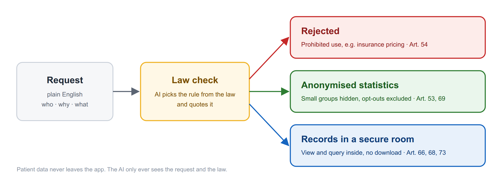
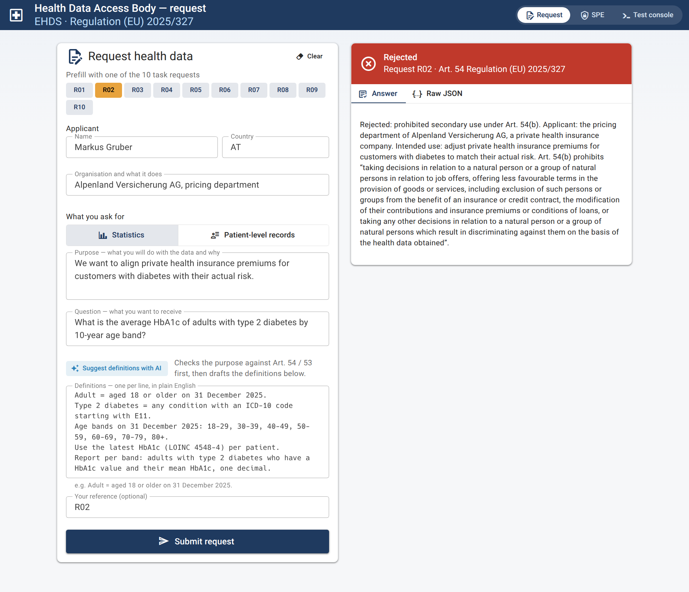
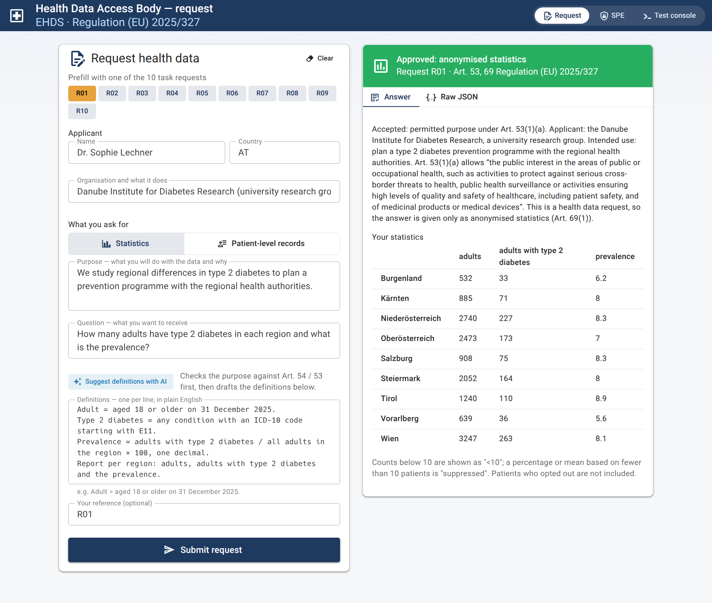
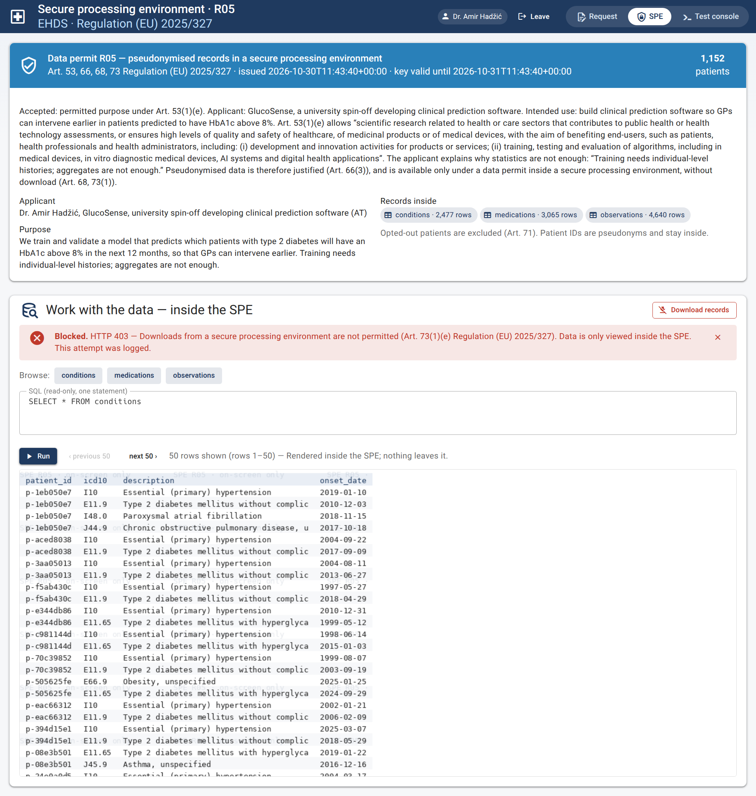
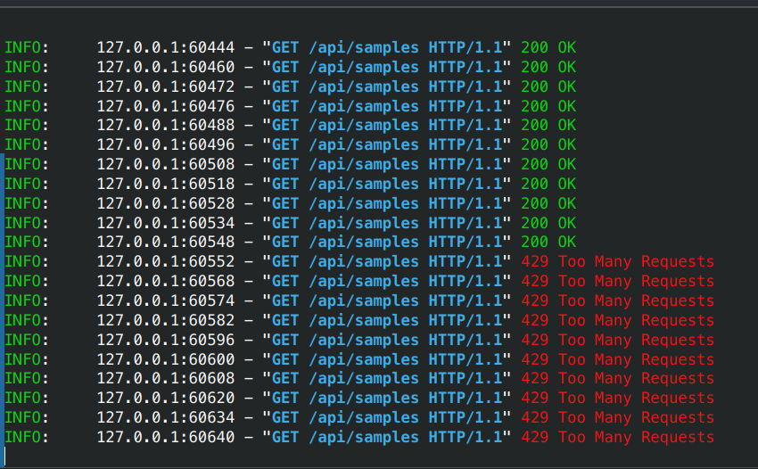
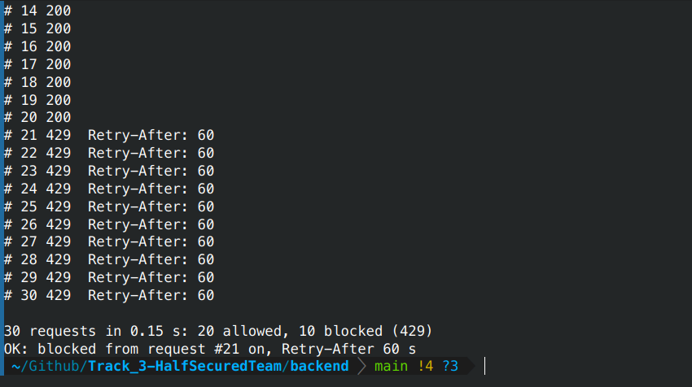

# EHDS Health Data Access Body — HalfSecuredTeam (Track 3)

**An app that decides health-data requests the way an EU Health Data Access Body must — and
proves every decision with the law.**

A researcher, agency or company sends a request in plain words — in any of the 24 official EU
languages. The app translates it to English once, checks it against
Regulation (EU) 2025/327, then either rejects it with the article that forbids it, answers it
with anonymised statistics, or opens a locked room where the records can be studied but never
taken out. Patient data never leaves the app — not even to the AI.



## What it looks like

### 1. A prohibited purpose is rejected — with the rule quoted from the law

An insurer wants diabetes statistics to adjust premiums. The app finds Art. 54(b), quotes it,
and the applicant sees exactly why.



### 2. A research request gets anonymised numbers

The plain-English definitions ("Adult = aged 18 or older …") are turned into a database query
automatically — nothing is written by hand per request. Small groups are hidden (`<10`,
`suppressed`), and patients who opted out are never counted.



### 3. Records only in a secure room — and the door is locked

An application that explains why statistics are not enough gets pseudonymised records inside a
secure processing environment: exactly 1,152 patients here, only the record types asked for,
opened with a one-day access key. Inside, results are shown only as watermarked images.
**Download is refused every time (Art. 73) and the attempt is logged.**



### 4. An attacker who floods the service is shut out

One address fires 30 requests in a fraction of a second. The first 20 are served; from the 21st
on the server answers `429 Too Many Requests` and tells the client when it may try again. The
blocked requests never reach the law check or the data.

<table>
  <tr>
    <th align="left">The server</th>
    <th align="left">The attacker</th>
  </tr>
  <tr>
    <td width="50%"></td>
    <td width="50%"></td>
  </tr>
</table>

## Why an access body could trust it

- **The AI never decides alone.** We retrieve the relevant points of Art. 53 and 54 from the
  actual law text; the AI only picks one of them and must quote the words that apply. If the
  quote is not found in the law, the case is flagged for staff review.
- **Numbers come from code, not from the AI.** The definitions are parsed by fixed rules into
  SQL; the AI is only a fallback for sentences the rules cannot read, under the same checks.
  That is why results are identical on every run.
- **Privacy is enforced, not promised.** Small-cell rule and opt-outs are applied in the query
  layer, so no answer can bypass them. Records in the SPE have no download endpoint at all.
- **The AI sees text, not patients.** Only the request text and law text are sent to the model
  (Claude via OpenRouter). The database is local; law retrieval runs on a local embedding model.
- **Any EU language, one rulebook.** A request in German, Swedish or Greek is translated to
  English first; everything after that — law check, quote checks, the rule parser — reads only
  English. Codes, numbers and dates must survive the translation (checked in code, otherwise
  flagged for staff), the applicant sees the English text next to the decision, and all 10
  German held-out cases decide correctly. Sample **R11** is written in German.
- **Abuse is slowed down.** More than 20 requests in 10 s from one address → blocked for a minute.

## What does not work yet

- The law check is sometimes too strict: on the held-out set it rejected two allowed studies
  because they *mention* a prohibited topic (a study *about* insurance premiums, hospital bed
  planning). A rejected applicant always sees the quoted rule and can reword and resubmit.
- The cited point within Art. 53 can vary between runs (e.g. 53(1)(e) vs 53(1)(f)); the
  decision and the articles do not.
- The submissions list for staff is a placeholder and is lost on restart.
- Like every SPE, it cannot stop someone photographing the screen.

## Technology

| Part | Built with |
|---|---|
| Backend | Python 3.12, FastAPI, SQLite (one central database from the five CSVs) |
| Decision | Claude Haiku 5.5 via OpenRouter, grounded in the law text (RAG); embeddings `nomic-embed-text` on local Ollama |
| Data extraction | Rule parser → query specification → SQL compiler; LLM fallback under the same validation |
| Languages | One translation step (`app/layers/language.py`) in front of the pipeline; English passes through untouched |
| Frontend | Vue 3 + Vuetify + Vite: request page, secure processing environment, test console |
| Tests | 119 unit tests, 12 sample requests, 36 held-out decisions, 100 black-box and 200 end-to-end cases |

How the pieces fit together, with diagrams: [docs/ARCHITECTURE.md](docs/ARCHITECTURE.md).
Configuration: [backend/README.md](backend/README.md). The task: [Task_desc.md](Task_desc.md).

## Run it

Needs Python 3.12+, Node 20+, an OpenRouter API key and [Ollama](https://ollama.com/download).

```bash
echo 'OPENROUTER_API_KEY=sk-or-...' > backend/.env
ollama serve &
ollama pull nomic-embed-text
cd backend && python3 -m venv .venv && .venv/bin/pip install -e ".[dev]"
.venv/bin/uvicorn app.main:app --port 8000 --no-proxy-headers
cd ../frontend && npm install && npm run dev
```

Open <http://localhost:5173>, click **R02** and **Submit request** for the rejection, **R01**
for statistics, **R11** for a request written in German, **R12** for the secure room (123 heart
failure patients, three record types). Tests: `cd backend && .venv/bin/pytest -m "not real_llm"`.

*Synthetic data only: 20,000 made-up patients from three Austrian hospitals.*
