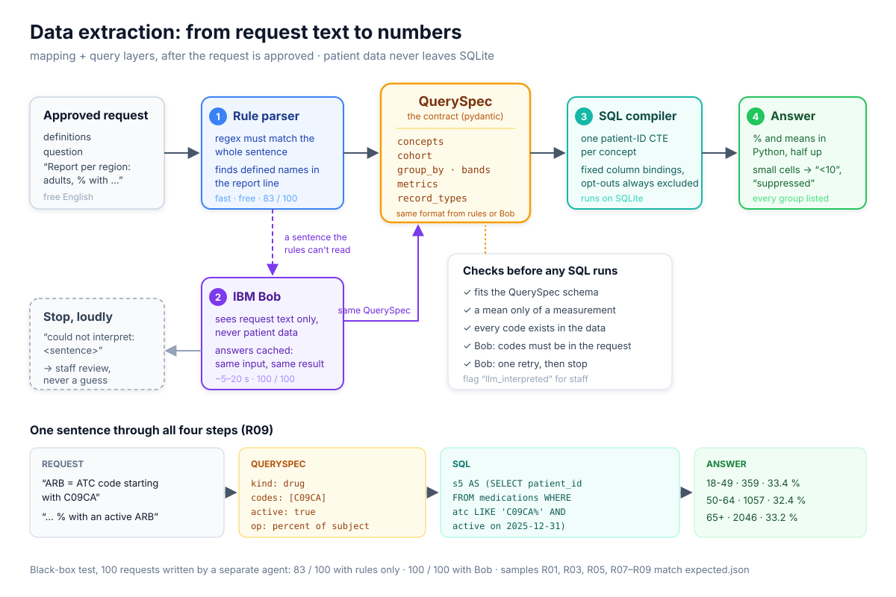

# Track 3 — EHDS Health Data Access Body (HalfSecuredTeam)

Takes a health-data request as JSON, decides `REJECT`, `APPROVE_STATISTICAL` or `APPROVE_SPE`
with the articles of Regulation (EU) 2025/327 and computes the answer under the small-cell rule.
Task: [`Task_desc.md`](Task_desc.md). Details: [`backend/README.md`](backend/README.md).

## Status — 30.10.2026

Done:

- [x] Decision, all four steps, grounded RAG: Claude Haiku 5.5 via OpenRouter, local embeddings:
  Art. 54 / 53 point picked by the LLM from retrieved law text and
  quoted; SPE vs. downgrade judged against Art. 66(2)/66(3) with a quote that must appear verbatim
  in the request (otherwise downgrade + staff flag); route articles (69, 66, 68, 73) grounded in
  the law text; `503` with a fix-it message when Ollama or OpenRouter fails
- [x] Data extraction from the definitions: 6/6 numbers, black-box 100/100 with the rules alone
  (hospital grouping, main diagnosis `primary_icd10`, stays vs. patients covered)
- [x] Small-cell rule and opt-outs in every statistical answer
- [x] SPE cohort: exact patient count (R05: 1,152) and the requested record types
- [x] Staff UI at <http://localhost:8000/> (`backend/app/static/index.html`): pick one of the
  10 task requests or the 200 end-to-end cases (E001..E200), run it, compare with the expected answer
- [x] SPE provisioning: one SQLite file per permit with only the cohort and the named tables,
  patient IDs kept, opt-outs out; the decision returns an access key, opened together with the
  applicant's name (see below)
- [x] Download block: `/api/spe/download` answers `403` with Art. 73 and logs the attempt; the
  file has no URL; query results reach the browser only as rendered images
- [x] SPE frontend (`frontend/`, Vue 3 + Vuetify + Vite): key + name entry, browse inside, SQL,
  blocked download
- [x] Data-extraction fallback via the OpenRouter LLM (IBM Bob removed)

To do, in priority order:

1. [ ] **Applicant and staff views for statistics**: decision, reason, articles for the applicant;
   evidence, grounding, flags (`needs_review`, `spe_quote_unverified`), SQL and code mapping for
   staff (the SPE frontend covers the SPE branch; the console at `/` is a test tool)
2. [ ] **`/api/submissions`**: return `pipeline.run` instead of placeholder results, or remove it
3. [ ] **Step 1 hardening** (misses on the held-out set, below): deterministic Art. 54 floor for
   unambiguous wording (nicotine, vape, e-liquid, tobacco, alcohol products, also German) and a
   tighter end-use prompt; tune on the `dev` split only
4. [ ] **Cleanup**: delete the stubs `layers/statistics.py`, `layers/spe.py`, `small_cell.apply`
5. [ ] **Persistence**: submissions survive a restart (SPE files already do, in `backend/spe/`)
6. [ ] **Submission**: rerun all metrics, final architecture section, public repo, demo video
   (≤ 2 min: R02 reject, R01 statistics, R05 SPE with the blocked download)

## Quick start

Needs Python 3.12+, an OpenRouter API key and [Ollama](https://ollama.com/download) for local
embeddings (~300 MB).

```bash
echo 'OPENROUTER_API_KEY=sk-or-...' > backend/.env   # decisions: anthropic/claude-haiku-5.5 via OpenRouter
ollama serve &   # or the Ollama desktop app
ollama pull nomic-embed-text   # local embeddings for law retrieval
cd backend && python3 -m venv .venv && .venv/bin/pip install -e ".[dev]"
.venv/bin/uvicorn app.main:app --port 8000
curl -X POST localhost:8000/api/requests -H 'Content-Type: application/json' -d @../requests/R02.json
.venv/bin/pytest -m "not real_llm"
cd ../frontend && npm install && npm run dev   # SPE frontend, http://localhost:5173
```

API docs: <http://localhost:8000/docs>. A `503` means Ollama is not running, the embedding model is missing, or the OpenRouter key is
missing/invalid.

## Architecture

```
                 ┌──────────────── decision (steps 1–4) ────────────────┐
request JSON ─▶  │ 1. Art. 54 / 53   RAG: retrieve points, LLM picks one │ ─▶ REJECT (Art. 54) ─▶ reason
                 │ 2–4. route        health data request → statistics   │
                 │                   access application → LLM checks    │
                 │                   Art. 66(3) justification → SPE     │
                 │                   or downgrade to statistics         │
                 └───────────────────────────────────────────────────────┘
                                      │ APPROVE_STATISTICAL / APPROVE_SPE
                                      ▼
                 definitions ─▶ rule parser ─▶ QuerySpec ─▶ SQL compiler ─▶ SQLite (data/ehds.db)
                                                                              │
                     statistics: aggregates ─▶ small-cell rule ─▶ answer ◀────┤
                     SPE: cohort patient IDs ─▶ backend/spe/<id>.db (cohort + named ◀──┘
                          tables) + access key ─▶ SPE frontend: queries as images,
                          download 403, output airlock
```

The backend is one FastAPI app (`backend/app/main.py`) on one central SQLite database built
from the five CSVs; the SPE has its own Vue frontend (`frontend/`). The only external call is the LLM on OpenRouter, and it only ever
receives request text and law text, never patient data.

### Components

| Component | Where | Approach |
|---|---|---|
| Law corpus | `app/rag/corpus.py`, `app/rag/store.py`, `data/law.db` | `eulex.html` (Regulation (EU) 2025/327) parsed into 406 chunks: each paragraph and each lettered point of Chapter IV (Art. 50–81) on its own, plus the recitals. Embedded once with `nomic-embed-text` (local Ollama) and committed; retrieval is cosine similarity over the chunks |
| Decision, steps 1–2 | `app/layers/decision.py` | Three small steps instead of one big question. **Extract** (LLM): actor, analysis and *end use* of the results, from organisation and purpose only. **Retrieve**: the end use is the query for the 3 closest points of Art. 53(1) and of Art. 54. **Match** (LLM): one of those 6 points by id (enum in the schema, so no invented articles), plus the words of the point that cover the use. **Code decides**: Art. 54 point → `REJECT`, Art. 53 point → accept; the reason quotes the point verbatim from `law.db`; words not found in the point → `needs_review` |
| Routing, steps 3–4 | `app/layers/routing.py` | Health data request → statistics (Art. 69(1)). Access application → Art. 66(2)/66(3) fetched by id, the LLM judges whether the application shows that anonymised statistics are not enough and quotes the sentence. Quote found verbatim in the request → `APPROVE_SPE` (66, 68, 73); otherwise downgrade to `APPROVE_STATISTICAL` (66, 69), flagged `spe_quote_unverified` when a justification was claimed but could not be quoted. Route articles come with their law text as grounding |
| LLM client | `app/rag/openrouter.py` | `anthropic/claude-haiku-5.5` via OpenRouter, strict JSON schema, routed only to endpoints that enforce it. No local cache: every request calls the model afresh; consistency comes from the strict JSON schema, the enum of retrieved points and the verbatim-quote checks |
| Data extraction | `app/layers/mapping.py`, `app/models.py` | Each definition sentence must fully match an ordered regex rule; named concepts (diagnosis → ICD-10 prefix, drug → ATC prefix and "active on 31.12.2025", measurement → LOINC with "latest value", age, sex, region, hospital, inpatient stay / main diagnosis, composites with AND/OR/NOT) become a `QuerySpec` (pydantic, the contract). Plain-English names are bound to the codes the definitions give; measurements also resolve from a built-in name → LOINC table. The "Report per …" line is read by finding the defined names and the operation (count, %, mean, negation). Any sentence not understood raises an error instead of being skipped; codes that match nothing in the data are rejected. Nothing is written per request |
| Fallback interpretation | `app/layers/llm_mapping.py` | Where the rules give up, the OpenRouter LLM fills the same `QuerySpec` under the same validation (request text only, codes must come from the request, flagged `llm_interpreted`, no local cache) |
| SQL compiler | `app/layers/query.py` | `QuerySpec` → SQLite SQL: a base view without opted-out patients, age on 31.12.2025, one patient-ID CTE per concept, one 0/1 flag per patient, grouping by region / hospital / sex / age band (or two of them), patients or stays as the unit |
| Small-cell rule | `app/layers/query.py`, `app/layers/small_cell.py` | Every requested group listed, also empty ones; counts below 10 → `<10`; percentages with numerator or denominator below 10 and means over fewer than 10 patients → `suppressed`; rounding in Python with `Decimal`, one decimal, half up. Answers name each value by its metric |
| SPE | `app/spe.py`, `app/spe_api.py` | The cohort query gives the exact patient count; the cohort and only the named record types are copied into one SQLite file per permit, opened with an access key + applicant name; read-only queries returned as watermarked images, download always `403`, output airlock with the small-cell check, audit log ([details below](#secure-processing-environment-art-73)) |
| API | `app/main.py` | `POST /api/requests` runs the whole pipeline and returns decision, articles, reason, grounding, evidence, flags, generated SQL and the answer; `/api/samples` serves the sample requests to the UI; `/api/submissions` keeps submissions in memory (placeholder results) |
| SPE frontend | `frontend/` (Vue 3 + Vuetify + Vite) | The applicant's workspace inside the SPE: key + name entry, tables, SQL, blocked download, outputs |
| Staff UI | `app/static/index.html` | Single page served at `/`: pick a task request or an end-to-end case, run it, see decision, reason, evidence, flags and SQL next to the expected answer, or run a batch |



### Test and evaluation assets

| Set | Where | Checks |
|---|---|---|
| Unit tests | `backend/tests/` | Layers on fakes (no network); `-m real_llm` runs against OpenRouter and Ollama |
| Task requests | `requests/R01–R10`, `expected.json` | Decision, articles and numbers |
| Held-out decisions | `tests/data/heldout_requests.json`, `tests/fixtures/eval/requests.json` | Accept/reject and full decision on requests not used for development (`dev` / `test` split) |
| Black-box extraction | `tests/fixtures/blackbox/` | 100 requests written separately, numbers computed independently of the parser |
| End-to-end | `tests/fixtures/e2e/` | 200 cases through the whole pipeline (`run.py`, `--no-llm` for routing and data only) |

### Secure processing environment (Art. 73)

An `APPROVE_SPE` decision creates `backend/spe/<request_id>.db` — a SQLite file with a `cohort`
table (the selected patient IDs, opted-out patients already excluded) and only the record types
the request names, joined to that cohort — and returns an **access key** in `data.spe.access_key`
(shown once; only its SHA-256 is stored). Nothing serves the file.

The applicant opens the SPE in the separate frontend (`frontend/`, Vue 3 + Vuetify + Vite,
<http://localhost:5173>) by entering the **key and their name as on the application**; both
have to match. Everything the page does goes through `/api/spe/*` with
`Authorization: Bearer <key>` and `X-Applicant: <name>` (percent-encoded):

| Endpoint | What it does |
|---|---|
| `POST /api/spe/access` | key + name → permit, cohort size, tables with row counts and columns |
| `POST /api/spe/query` | one read-only statement; the first 50 rows come back as a **PNG** with a watermark, never as text. Writes, `ATTACH`, `PRAGMA`, the bookkeeping tables and runaway queries are refused |
| `GET /api/spe/download` | always `403`, Art. 73(1)(e), logged |

There is no other endpoint: nothing returns records as a file or as text, the on-screen table is
an image, and every query, blocked download and failed login (with the name tried) is written to
the SPE's `audit_log`. It does not prevent photographing the screen, which no SPE does. In
production the same contract would be run by a trusted research environment (Findata Kapseli, an
Azure TRE airlock, OpenSAFELY), which would add a checked output channel (e.g.
[ACRO](https://pypi.org/project/acro/)) — out of scope here.

Run the frontend: `cd frontend && npm install && npm run dev` (proxies `/api` to
`http://localhost:8000`; set `EHDS_API_URL` for another backend).

## Metrics

On the 10 requests, through `pipeline.run` (what the API returns), `anthropic/claude-haiku-5.5`
via OpenRouter (no cache; every run calls the model):

| Metric | Target | Now |
|---|---|---|
| Correct decisions | 10 of 10 | 10 of 10 (decision + articles) |
| Correct numbers | 6 of 6 | 6 of 6 |
| Privacy leaks | 0 | 0 |
| Consistency (3 runs) | 10 of 10 | 10 of 10 with `qwen2.5:7b`; to be re-measured with Haiku 5.5 |
| Slowest answer | under 60 s | 6.0 s |

Held-out evaluation set, `test` split (36 requests, `scripts/evaluate.py --split test`), measured
with local `qwen2.5:7b` before the switch, to be re-measured with Haiku 5.5: 31 of 36 full decisions correct; routing SPE 4/5, downgrade 4/4. Misses: three prohibited
purposes accepted (two nicotine/vape products, one in German, and a subsidy cut that
disadvantages a group), one study *about* insurance premiums rejected, one SPE request with a
bare "requires patient-level data" downgraded.
