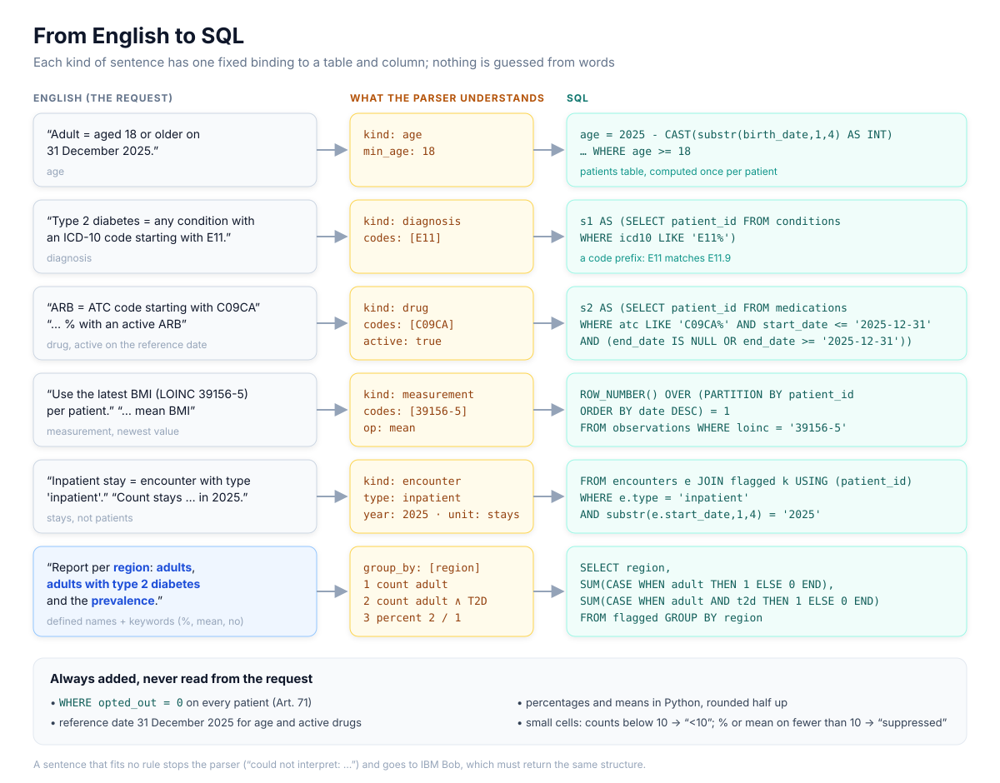

# Backend

| Layer | File | What it does |
|---|---|---|
| Decision | `app/layers/decision.py` | `rag` (default) or `purpose` engine, see below |
| Routing | `app/layers/routing.py` | statistics, SPE or downgrade; adds Art. 66/68/69/73 |
| Mapping | `app/layers/mapping.py`, `llm_mapping.py` | definitions → `QuerySpec` (rules, then IBM Bob) |
| Query | `app/layers/query.py` | `QuerySpec` → SQLite SQL → answer |
| Small-cell rule | `app/layers/small_cell.py` | `<10`, `suppressed`, one decimal half up |
| SPE copy | `app/layers/spe.py` | stub |

Interfaces: `app/models.py`. Wiring: `app/pipeline.py`. API: `app/main.py`.

## Setup and run

```bash
python3 -m venv .venv && .venv/bin/pip install -e ".[dev]"
.venv/bin/uvicorn app.main:app --reload --port 8000
.venv/bin/pytest -m "not real_llm"                # fast, no Ollama
.venv/bin/python -m app.eval_decisions            # decisions: 10 samples + 16 held-out
.venv/bin/python tests/fixtures/blackbox/run.py   # data extraction: 100 black-box requests
```

Rebuild the committed databases only after changing their sources:
`python -m app.db` (`data/ehds.db` from the CSVs), `python -m app.rag.corpus` (`data/law.db` from `eulex.html`).

| Variable | Default | Use |
|---|---|---|
| `EHDS_DECISION_ENGINE` | `rag` | `purpose` for the purpose check |
| `EHDS_LLM_MODEL` | `qwen2.5:7b` | Ollama model for `rag` |
| `EHDS_OLLAMA_URL` | `http://localhost:11434` | Ollama on another machine |
| `EHDS_LLM` | `on` | `off` disables IBM Bob in data extraction |
| `EHDS_PURPOSE_ENGINES` | from `config.yaml` | e.g. `nli,rules` |

## Decision: `rag` engine

- `eulex.html` is split into 406 chunks (each point of Art. 50–81, the recitals) and embedded in `data/law.db`.
- The LLM extracts the **end use** from organisation and purpose; the 3 closest points of Art. 53(1)
  and of Art. 54 are retrieved; the LLM picks one and quotes it. Words not in the law → `needs_review`.
- Art. 54 point → reject, Art. 53 point → accept. Ollama `qwen2.5:7b`, temperature 0, fixed seed.

## Decision: `purpose` engine

- Tries IBM Bob, then a local NLI model (`MoritzLaurer/bge-m3-zeroshot-v2.0`, CPU), then rules
  (`app/purpose/config.yaml`). A rule hit always rejects. Every decision quotes its sentence.
- NLI model: `pip install torch --index-url https://download.pytorch.org/whl/cpu && pip install -e ".[nli]"`.
- Evaluation set: `tests/fixtures/eval/requests.json` (100 requests, tune on `dev`, report `test`).

## Data extraction



- Each definition must fully match a regex rule; the report line is read via the defined names.
  Anything not understood raises `InterpretError`, never skipped.
- Where the rules give up, IBM Bob (`bob run --mode ask`, request text only) fills the same
  `QuerySpec`; same checks, codes must come from the request, answers cached in `.cache/llm/`,
  result flagged `llm_interpreted`.
- One patient-ID CTE per concept, no correlated subqueries; rounding and small cells in Python.
- Black-box set in `tests/fixtures/blackbox/`, written by a separate agent; `run.py --verbose ID` shows one case.
