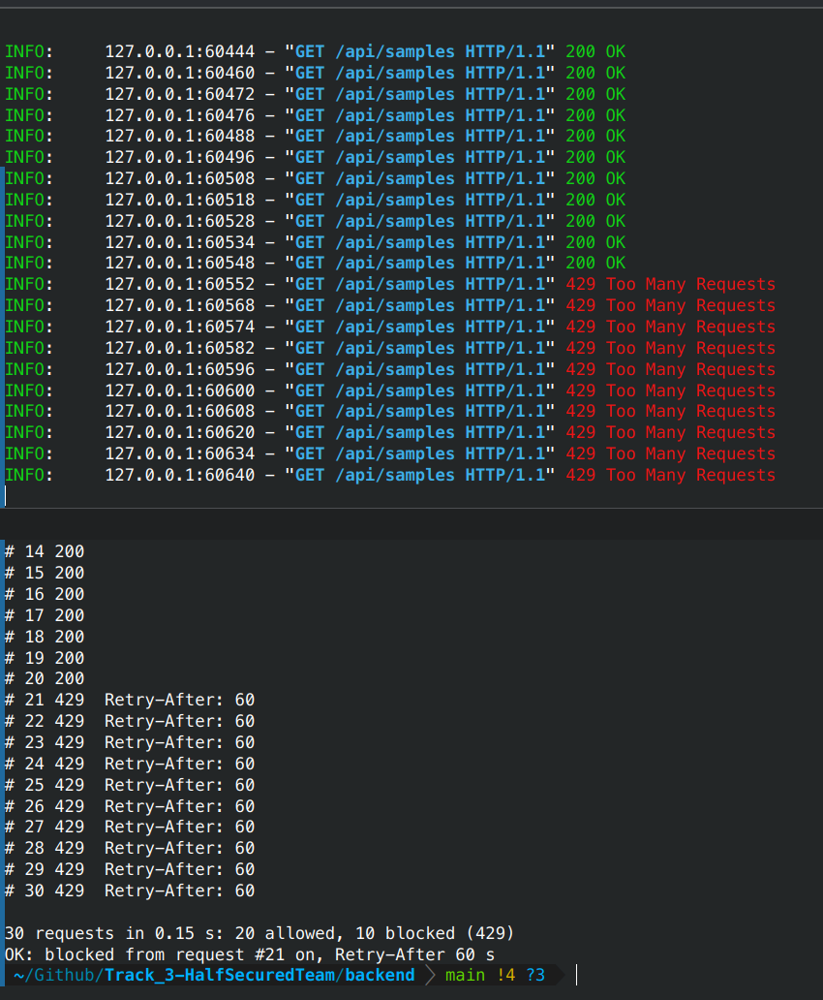

# Architecture

Technical companion to the [README](../README.md). Configuration and environment variables:
[`backend/README.md`](../backend/README.md).

```
                 ┌──────────────── decision (steps 1–4) ────────────────┐
request JSON ─▶  │ 1. Art. 54 / 53   RAG: retrieve points, LLM picks one │ ─▶ REJECT (Art. 54) ─▶ reason
                 │ 2–4. route        health data request → statistics   │
                 │                   access application → LLM checks    │
                 │                   Art. 66(3) justification → SPE     │
                 │                   or downgrade to statistics         │
                 └───────────────────────────────────────────────────────┘
                                      │ APPROVE_STATISTICAL / APPROVE_SPE
                                      ▼
                 definitions ─▶ rule parser ─▶ QuerySpec ─▶ SQL compiler ─▶ SQLite (data/ehds.db)
                                                                              │
                     statistics: aggregates ─▶ small-cell rule ─▶ answer ◀────┤
                     SPE: cohort patient IDs ─▶ backend/spe/<id>.db (cohort + named ◀──┘
                          tables) + access key ─▶ SPE frontend: queries as images,
                          download 403
```

The backend is one FastAPI app (`backend/app/main.py`) on one central SQLite database built
from the five CSVs; the frontend (`frontend/`, Vue 3 + Vuetify + Vite) has three pages: the
applicant's request page (`#/apply`), the secure processing environment (`#/spe`) and the test
console (`#/console`). The only external call is the LLM on OpenRouter, and it only ever
receives request text and law text, never patient data. Embeddings for law retrieval run on
local Ollama.

## Components

| Component | Where | Approach |
|---|---|---|
| Law corpus | `app/rag/corpus.py`, `app/rag/store.py`, `data/law.db` | `eulex.html` (Regulation (EU) 2025/327) parsed into 406 chunks: each paragraph and each lettered point of Chapter IV (Art. 50–81) on its own, plus the recitals. Embedded once with `nomic-embed-text` (local Ollama) and committed; retrieval is cosine similarity over the chunks |
| Decision, steps 1–2 | `app/layers/decision.py` | Three small steps instead of one big question. **Extract** (LLM): actor, analysis and *end use* of the results, from organisation and purpose only. **Retrieve**: the end use is the query for the 3 closest points of Art. 53(1) and of Art. 54. **Match** (LLM): one of those 6 points by id (enum in the schema, so no invented articles), plus the words of the point that cover the use. **Code decides**: Art. 54 point → `REJECT`, Art. 53 point → accept; the reason quotes the point verbatim from `law.db`; words not found in the point → `needs_review` |
| Routing, steps 3–4 | `app/layers/routing.py` | Health data request → statistics (Art. 69(1)). Access application → deterministic floor (a sentence that says statistics/aggregates are not enough) and, failing that, the LLM judges against Art. 66(2)/66(3) and quotes the sentence. Quote found verbatim in the request → `APPROVE_SPE` (66, 68, 73); otherwise downgrade to `APPROVE_STATISTICAL` (66, 69), flagged `spe_quote_unverified` when a justification was claimed but could not be quoted. Route articles come with their law text as grounding |
| LLM client | `app/rag/openrouter.py` | `anthropic/claude-haiku-5.5` via OpenRouter, strict JSON schema, routed only to endpoints that enforce it. No local cache: every request calls the model afresh; consistency comes from the strict JSON schema, the enum of retrieved points and the verbatim-quote checks |
| Data extraction | `app/layers/mapping.py`, `app/models.py` | Each definition sentence must fully match an ordered regex rule; named concepts (diagnosis → ICD-10 prefix, drug → ATC prefix and "active on 31.12.2025", measurement → LOINC with "latest value", age, sex, region, hospital, inpatient stay / main diagnosis, composites with AND/OR/NOT) become a `QuerySpec` (pydantic, the contract). Plain-English names are bound to the codes the definitions give; measurements also resolve from a built-in name → LOINC table. The "Report per …" line is read by finding the defined names and the operation (count, %, mean, negation). Any sentence not understood raises an error instead of being skipped; codes that match nothing in the data are rejected. Nothing is written per request |
| Fallback interpretation | `app/layers/llm_mapping.py` | Where the rules give up, the OpenRouter LLM fills the same `QuerySpec` under the same validation (request text only, codes must come from the request, flagged `llm_interpreted`, no local cache) |
| SQL compiler | `app/layers/query.py` | `QuerySpec` → SQLite SQL: a base view without opted-out patients, age on 31.12.2025, one patient-ID CTE per concept, one 0/1 flag per patient, grouping by region / hospital / sex / age band (or two of them), patients or stays as the unit |
| Small-cell rule | `app/layers/query.py`, `app/layers/small_cell.py` | Every requested group listed, also empty ones; counts below 10 → `<10`; percentages with numerator or denominator below 10 and means over fewer than 10 patients → `suppressed`; rounding in Python with `Decimal`, one decimal, half up. Answers name each value by its metric |
| SPE | `app/spe.py`, `app/spe_api.py` | The cohort query gives the exact patient count; the cohort and only the named record types are copied into one SQLite file per permit, opened with an access key + applicant name; read-only queries returned as watermarked images, download always `403`, audit log ([details below](#secure-processing-environment-art-73)) |
| Suggest definitions | `app/suggest.py` | `POST /api/requests/suggest-definitions`: the Art. 54/53 check first, then the LLM drafts definitions in the task's wording and the parser confirms they are computable |
| Rate limit | `app/ratelimit.py` | Per client IP on `/api/*`: more than 20 calls in 10 s → blocked 60 s, `429` + `Retry-After` ([details below](#rate-limit)) |
| API | `app/main.py` | `POST /api/requests` runs the whole pipeline and returns decision, articles, reason, grounding, evidence, flags and the answer (generated SQL and code mapping only with `?debug=1`); `/api/samples` serves the sample requests; `/api/submissions` keeps submissions in memory (placeholder results, not wired to the pipeline) |
| Request page | `frontend/` (`#/apply`) | Form (prefill with R01–R10), "Suggest definitions with AI", the decision with reason and articles, statistics table or SPE access key; raw JSON tab |
| SPE frontend | `frontend/` (`#/spe`) | Key + name entry, tables, SQL, blocked download |
| Test console | `frontend/` (`#/console`) | Pick a task request or an end-to-end case, run it, see decision, reason, evidence, flags and SQL next to the expected answer, or run a batch |


## Test and evaluation assets

| Set | Where | Checks |
|---|---|---|
| Unit tests | `backend/tests/` | Layers on fakes (no network); `-m real_llm` runs against OpenRouter and Ollama |
| Task requests | `requests/R01–R10`, `expected.json` | Decision, articles and numbers |
| Held-out decisions | `tests/data/heldout_requests.json`, `tests/fixtures/eval/requests.json` | Accept/reject and full decision on requests not used for development (`dev` / `test` split) |
| Black-box extraction | `tests/fixtures/blackbox/` | 100 requests written separately, numbers computed independently of the parser |
| End-to-end | `tests/fixtures/e2e/` | 200 cases through the whole pipeline (`run.py`, `--no-llm` for routing and data only) |
| Rate limit | `tests/test_ratelimit.py`, `scripts/flood.py` | Limiter unit tests; a live burst against a running API |

## Secure processing environment (Art. 73)

An `APPROVE_SPE` decision creates `backend/spe/<request_id>.db` — a SQLite file with a `cohort`
table (the selected patient IDs, opted-out patients already excluded) and only the record types
the request names, joined to that cohort — and returns an **access key** in `data.spe.access_key`
(shown once; only its SHA-256 is stored; valid for 24 hours, `EHDS_SPE_KEY_TTL_HOURS`). Nothing serves the file.

The applicant opens the SPE in the frontend (`#/spe`) by entering the **key and their name as on
the application**; both have to match. Everything the page does goes through `/api/spe/*` with
`Authorization: Bearer <key>` and `X-Applicant: <name>` (percent-encoded):

| Endpoint | What it does |
|---|---|
| `POST /api/spe/access` | key + name → permit, cohort size, tables with row counts and columns |
| `POST /api/spe/query` | one read-only statement; the first 50 rows come back as a **PNG** with a watermark, never as text. Writes, `ATTACH`, `PRAGMA`, the bookkeeping tables and runaway queries are refused |
| `GET /api/spe/download` | always `403`, Art. 73(1)(e), logged |

There is no other endpoint: nothing returns records as a file or as text, the on-screen table is
an image, and every query, blocked download and failed login (with the name tried) is written to
the SPE's `audit_log`. It does not prevent photographing the screen, which no SPE does. In
production the same contract would be run by a trusted research environment (Findata Kapseli, an
Azure TRE airlock, OpenSAFELY), which would add a checked output channel (e.g.
[ACRO](https://pypi.org/project/acro/)) — out of scope here.

## Rate limit

Every `/api/*` call counts per client IP: more than 20 within 10 s blocks the address for 60 s
with `429 Too Many Requests` and a `Retry-After` header, so one machine cannot flood the
LLM-backed endpoints (`EHDS_RATE_LIMIT_REQUESTS`, `_WINDOW_S`, `_BLOCK_S`). The check runs
before CORS and before any route. `X-Forwarded-For` is ignored unless `EHDS_TRUST_PROXY=1`,
because a client can set that header itself; without a reverse proxy start uvicorn with
`--no-proxy-headers`, since its own proxy-header handling trusts `127.0.0.1` by default.
State is per process and in memory; a multi-worker deployment would move it to the proxy or Redis.

`backend/scripts/flood.py` sends a burst from one address and checks the behaviour; below the
uvicorn log (top) and the script (bottom) for 30 requests:



## What the LLM sees

Five call sites, all through `app/rag/openrouter.py`; none of them ever includes a query result,
a row, a patient ID or SPE content:

| Call | Prompt content |
|---|---|
| `decision.extract` | applicant organisation + purpose |
| `decision.match` | retrieved law points (Art. 53/54) + the extracted facts |
| `routing.check_spe` | Art. 66 text + purpose, question, definitions |
| `llm_mapping.interpret` | schema, worked examples, question + definitions, the rule parser's error |
| `suggest.suggest` | applicant, requested_as, purpose, question, definitions so far |

The only database reads that reach a prompt are the distinct region and hospital names.

## Metrics

Task requests (`scripts/evaluate.py --set tasks --runs 3`, 30 Oct 2026, `anthropic/claude-haiku-5.5`,
no cache): 10/10 decisions and articles, 0 flagged for review, 0/10 inconsistent across 3 runs,
slowest decision 5.7 s. Numbers 6/6 via `pipeline.run`; black-box extraction 100/100.

Held-out set, `test` split (`scripts/evaluate.py --split test`, 36 requests, 6 in German):
34/36. All 13 prohibited purposes rejected (54(1)(a)–(d)), SPE 5/5, downgrade 4/4. The two
misses are over-strict: a study *about* whether depression raises insurance premiums (for
consumer-protection law) and "capacity planning of hospital beds" were rejected under Art. 54.

## Known gaps

- Over-strict Art. 54 matches when a permitted study mentions a prohibited topic (above).
- The point cited within Art. 53(1) can vary between runs ((e) vs (f) for R05); decision and
  articles are stable, which is what the consistency metric measures.
- `/api/submissions` still returns placeholder results and lives in memory; submissions do not
  survive a restart (SPE files do).
